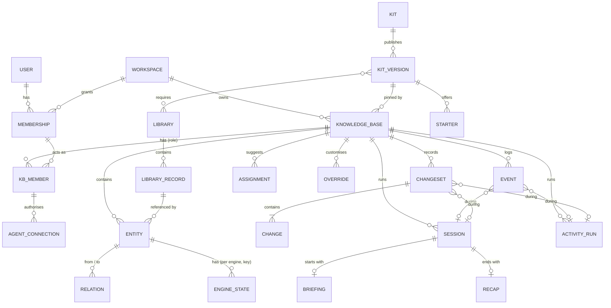

# Mnemo — Domain Model

> Companion to [PLAN.md](PLAN.md). Describes the concepts, their relationships, the rules they must
> always respect (invariants), and how the main flows change them. Names here are the internal
> ones; the UI uses plain words (§5 of the plan: template, space, Up next…).

## 1. Bounded contexts

The domain splits into six areas with clear ownership. Each owns its data; others refer to it by ID.

| Context | Owns | Depends on |
|---|---|---|
| **Identity & access** | User, Workspace, Membership, AgentConnection | — |
| **Kits** | Kit, KitVersion and its definitions (entity types, roles, engines, activities, skills, setup, starters…) | Libraries |
| **Libraries** | Library, LibraryRecord (shared, read-only reference data) | — |
| **Knowledge base** (core) | KnowledgeBase, Entity, Relation, Event, EngineState, Override | Kits, Identity |
| **Change tracking** | Changeset (draft or applied), Change (audit, undo, previews) | Knowledge base |
| **Sessions** | Session, Briefing, Recap | Knowledge base |
| **Activities** | ActivityRun, Assignment, Signal (computed) | Knowledge base, Kits |
| *Registry (later)* | Publisher, Package, Review | Kits |

```
 Identity & access ──┐
                     ▼
 Libraries ◀── Kits ──▶ Knowledge base ◀──── Change tracking (every write, drafts)
     └───────── referenced by entities ──┘
                  ▲          ▲
            Sessions     Activities
```

## 2. Overview diagram



## 3. Identity & access

| Concept | Key fields | Notes |
|---|---|---|
| **User** | `id`, `email`, `display_name`, `locale` (`en`), `native_language` | Local mode: one fixed user. |
| **Workspace** | `id`, `name`, `kind: personal \| team` | Every user gets a personal workspace. |
| **Membership** | `user_id`, `workspace_id`, `workspace_role: owner \| admin \| member` | Who belongs to the workspace. |
| **KbMember** | `kb_id`, `user_id`, `access: owner \| editor \| viewer`, `kit_roles: [RoleId]` | Access to one KB. `kit_roles` come from the kit (`gm`, `player`, `learner`). |
| **AgentConnection** | `id`, `kb_id`, `user_id`, `client` (Claude Code, desktop…), `scopes: read \| write`, `token_hash`, `last_seen_at`, `revoked_at?` | One per connected Claude. An agent always acts **as a KbMember**, never with more rights. |

**Actor** — who did something. Used on events, changesets, sessions:

```rust
enum Actor {
    Member  { user_id: UserId },                       // via the dashboard
    Agent   { user_id: UserId, connection_id: ConnId }, // Claude through MCP
    Engine  { engine: EngineRef },                     // effects from engine hooks
    System,                                            // imports, migrations, scheduled jobs
}
enum Channel { Dashboard, Mcp, Activity, Engine, Import, Migration }
```

**Invariants**
- A workspace always has at least one `owner`.
- A KB always has at least one `owner` KbMember.
- An agent's effective rights = its KbMember's rights ∩ the connection's `scopes`.
- **Local mode:** one fixed user and a **per-install token** (stored in the data folder, never
  shown to the user); every request must carry it and pass `Origin` validation. Hosted mode
  replaces it with OAuth tokens per AgentConnection.
- Revoking a KbMember revokes all their AgentConnections for that KB.

## 4. Kits

A kit is **immutable once a version is published**. Everything below belongs to a `KitVersion`.

| Concept | Key fields |
|---|---|
| **Kit** | `id` (`@scope/name`), `latest_version`, `source: local \| git \| registry` |
| **KitVersion** | `kit_id`, `version` (semver), `sha256`, `requires`, `extends?`, `license`, `yanked`, `manifest` |
| **RoleDef** | `id`, `name`, `description` (e.g. `gm`, `player`, `learner`; `owner` is implicit) |
| **EntityTypeDef** | `id`, `fields: [FieldDef]`, `visibility: VisibilityPolicy`, `editable_by: [RoleId \| "owner"]`, `display` (title field, icon), `lifecycle?: note \| thread`, `dedupe_on?` (fields used for duplicate checks, default: title) |
| **FieldDef** | `name`, `type` (`text`, `markdown`, `int`, `float`, `bool`, `date`, `timestamp`, `json`, `enum[…]`, `ref(type)`, `list(T)`; `object{…}` not yet supported), `required`, `default`, `visibility?` (field-level) |
| **RelationTypeDef** | `id`, `from_type`, `to_type`, `cardinality` (e.g. `npc —member_of→ faction`) |
| **EventTypeDef** | `id`, `payload_schema`, `class: story \| evidence \| bookkeeping`, `visibility?` |
| **EngineBinding** | `engine` (built-in id or kit engine), `version_req`, `config` (validated by the engine's `config_schema`) |
| **ActivityDef** | `id`, `title`, `engine`, `presenter`, `select`, `map`, `grading`, `skill?` |
| **SkillDef** | `name`, `description`, `files` (SKILL.md + references), `has_scripts` |
| **BriefingDef** | per role: ordered sections (built-in or engine-provided) |
| **ViewDef** | `id`, `kind` (table, board, timeline, chart…), `config` |
| **SetupDef** | `skill` (required), `starters: [StarterId]`, `libraries: [LibraryId]` |
| **StarterDef** | `id`, `title`, `description`, `contents` (entities + relations, in kit types), `adaptable_fields?` |
| **SettingsSchema** | User-facing settings with defaults (lesson length, accent strictness…) |
| **Migration** | `from_version`, `to_version`, steps (add/rename/remove field, transform, move type) |
| **Expr** | A CEL expression (computed fields, rule conditions, activity `map`, visibility conditions) |
| **Filter** | `{ type: [TypeId], where?: Expr, include?: { history }, sort?: [{field, dir}], limit? }` — the one query format used by kits, MCP tools, briefings, activities and views |

**Invariants (checked by `kit validate`)**
- Every `Expr` and `Filter` type-checks against the kit's types and the variables in scope.
- Every `ref(type)`, relation endpoint, role, engine, presenter and activity referenced exists.
- Every MCP tool, entity type and role mentioned in a skill exists.
- `setup.skill` exists; every starter's contents validate against the kit's types; every library
  used by setup or tools is listed in `requires.libraries` and resolvable.
- Engine `config` matches the engine's `config_schema`; `requires` is satisfiable by the platform.
- `extends` chains have depth ≤ 1 and the merged result is valid.
- A published `(kit_id, version)` never changes; `sha256` matches the archive.

## 5. Libraries

Shared, read-only reference data that kits and Claude **pick from** instead of inventing (accurate
translations, stress marks, frequency ranks, official rules). A library is its own package type,
installed once per server and shared by all spaces.

| Concept | Key fields |
|---|---|
| **Library** | `id` (`@scope/name`), `version`, `sha256`, `license`, `attribution`, `record_schema`, `search_fields`, `installed_at` |
| **LibraryRecord** | `library_id`, `record_id` (stable across versions), `data`, `rank?`, search index entries |
| **LibraryRef** (on an entity) | `library_id`, `record_id`, `library_version` it was imported from |

**Invariants**
- A library version is immutable; `record_id`s stay stable across versions (removals are marked,
  not reused).
- Importing a record creates an entity whose `data` is mapped from the record (by the kit's import
  mapping) and keeps a `LibraryRef`; the user's progress lives in the entity and engine state,
  never in the library.
- A library upgrade never changes entities silently: changed records produce an **update draft**
  ("12 words have corrected stress marks") the user can accept.

## 6. Knowledge base (core)

### KnowledgeBase (aggregate root)

| Field | Notes |
|---|---|
| `id`, `workspace_id`, `name` | |
| `kit_id`, `kit_version`, `kit_sha256` | Pinned exactly (lockfile-like). |
| `settings` | Values for the kit's `SettingsSchema`. |
| `status: active \| paused \| archived \| upgrading` | `paused` blocks agent access. `upgrading` blocks writes during a migration. |
| `created_at`, `updated_at`, `schema_version` | |

### Entity

| Field | Notes |
|---|---|
| `id` (UUIDv7), `kb_id`, `type` | `type` ∈ kit's `EntityTypeDef`s. |
| `data` (JSON) | Always valid against the type's fields. |
| `owner_user_id?` | E.g. the player who owns a character; matches `editable_by: owner`. |
| `revealed_to: [RoleId \| UserId]` | Grants beyond the type's default policy (e.g. NPC revealed to players). |
| `version` (int) | Optimistic locking: every update must send the version it read. |
| `source: setup \| starter \| library \| member \| agent \| activity \| engine \| import` | Where it was created. |
| `library_ref?` | Link to the library record it came from (see §5). |
| `status?: open \| resolved \| superseded` | Only for types with a `lifecycle`. Resolved/superseded items are hidden from briefings and default search. |
| `superseded_by?`, `valid_until?` | Lifecycle links: the item that replaces it; when it stops being relevant. |
| `created_at`, `updated_at`, `deleted_at?` | Soft delete; hard delete only via "delete space" or purge. |

### Relation

`id`, `kb_id`, `type`, `from_entity`, `to_entity`, `data?`, `created_at`. Visible only if **both**
ends are visible to the viewer.

### Event (append-only)

| Field | Notes |
|---|---|
| `id`, `kb_id`, `type`, `payload` | `type` ∈ kit's `EventTypeDef`s or a platform type (`session_started`, `activity_completed`, `entity_revealed`…). |
| `class: story \| evidence \| bookkeeping` | From the event type. *Story*: what happened. *Evidence*: observations engines learn from (e.g. `review_recorded`). *Bookkeeping*: engine housekeeping. |
| `subjects: [EntityId]` | Entities the event is about (for timelines and engines). |
| `actor`, `channel` | Who and how. |
| `session_id?`, `activity_run_id?` | Context. |
| `visibility?` | Defaults to the most restrictive visibility of its subjects. |
| `at` | |

Events are **facts**: never edited, never deleted (except when the whole KB is deleted). A wrong
fact is corrected by a new event, and undo writes a compensating changeset (§7).

**Retention: everything is kept, with no compaction for now.** To keep the log meaningful and
make compaction possible later without a redesign, raw activity facts (keystrokes, timings) live
in `ActivityRun.results`, not in events: a run emits one *evidence* event per item (the rating)
and one `activity_completed` *story* event.

**Entity history** is not a separate table: any past version of an entity is rebuilt from its
changesets (`before`/`after`), which also powers `as_of` queries.

### EngineState

`kb_id`, `engine`, `entity_id`, `key`, `state` (JSON), `version`, `updated_at`.
`key` lets one engine keep several states per entity — e.g. FSRS keeps one card per skill:
`(fsrs, item:молоко, "spelling")`, `(fsrs, item:молоко, "recall")`.

### Override

`id`, `scope: kb \| workspace`, `target: skill \| setting \| briefing`, `name`, `content`,
`based_on_kit_version`. Re-applied after upgrades; flagged as a conflict if the kit changed the same
target.

**Invariants**
- `entity.type`, `event.type`, `relation.type` and every `engine_state.engine` exist in the KB's
  pinned kit version.
- `entity.data` validates against its type at all times (including after migrations).
- `relation` endpoints are in the same KB and match the relation type's `from_type` / `to_type`.
- All rows of a KB carry its `kb_id`; nothing references across KBs.
- No writes while `status = upgrading`; no agent access while `paused`.

## 7. Change tracking (audit and undo)

Every write — from a member, an agent, an activity, an engine or a migration — goes through one
**Changeset**, applied in one transaction.

| Concept | Fields |
|---|---|
| **Changeset** | `id`, `kb_id`, `actor`, `channel`, `session_id?`, `activity_run_id?`, `summary` (human text: "Claude marked 'молоко' as known"), `status: draft \| applied \| discarded`, `preview?` (counts and highlights for drafts), `reverts?: ChangesetId`, `expires_at?` (drafts), `at` |
| **Change** | `changeset_id`, `target: entity \| relation \| engine_state \| settings`, `target_id`, `op: create \| update \| delete`, `before?`, `after?` |

Events created in the same transaction reference the changeset.

**Drafts** are changesets that are validated but **not applied**: used for setup, starters,
library imports and any large change Claude proposes. They don't affect reads (except their own
preview). Applying a draft re-validates it and checks that its targets haven't changed since it
was built (versions); if they have, the draft is rebuilt or the conflict is shown. Drafts expire
if left unapplied (e.g. after 7 days). At most one open **setup** draft per KB.

**Undo** = create a new changeset with `reverts = <id>` whose changes restore `before`.
Allowed only if no later changeset modified the same targets (otherwise: show the conflict and
offer to revert the later ones too). Events are never removed; an `undone` event is appended.

## 8. Sessions

| Concept | Fields |
|---|---|
| **Session** | `id`, `kb_id`, `user_id`, `role` (kit role used), `channel: mcp \| dashboard`, `connection_id?`, `status`, `started_at`, `ended_at?`, `title?` |
| **Briefing** | `session_id`, `role`, `sections: [{id, title, content, truncated}]`, `token_estimate`, `generated_at` |
| **Recap** | `session_id`, `summary` (written by Claude), `changeset_ids`, `event_ids`, `next_steps?` |

```
Session status:  open ──end_session──▶ closed
                   └──(idle timeout)──▶ abandoned ──(late end_session)──▶ closed
```

**Invariants**
- At most one `open` session per (KB, user, connection).
- A briefing only contains data visible to the session's role and user (§10).
- Writes made through MCP while a session is open are linked to it.

## 9. Activities

| Concept | Fields |
|---|---|
| **ActivityRun** | `id`, `kb_id`, `user_id`, `activity` (ActivityDef id), `assignment_id?`, `items: [EntityId]`, `results: [ItemResult]`, `summary`, `status: started \| completed \| abandoned`, `started_at`, `ended_at?` |
| **ItemResult** | `entity_id`, `raw` (presenter-specific facts: answer, errors, timing…), `at` |
| **Assignment** | `id`, `kb_id`, `activity`, `items?`, `note`, `assigned_by: Actor`, `assigned_to: UserId`, `status: open \| done \| dismissed \| expired`, `due_at?` |
| **Signal** *(computed, not stored)* | `engine`, `label`, `priority`, `count?`, `opens: activity \| view`, `items?` |

Flow: `next_items` → client runs the presenter → results posted in batches → `on_activity_result`
returns effects → one changeset per batch + `activity_completed` event at the end.

**Invariants**
- Results can only reference items that were served in that run.
- Batches are idempotent (each has a client-generated ID; re-sending doesn't double-count).
- Completing a run linked to an assignment marks the assignment `done`.

## 10. Visibility (who sees what)

Evaluated on **every read**, for the dashboard, MCP tools, briefings, search, events and engine
host calls. Never left to the model.

```
can_see(viewer, entity) =
     viewer.access == owner                                   # KB owners see everything
  || type.visibility allows any of viewer.kit_roles
  || entity.owner_user_id == viewer.user_id
  || entity.revealed_to ∩ (viewer.kit_roles ∪ {viewer.user_id}) ≠ ∅

visible_fields(viewer, entity) = fields whose field-level visibility passes the same test
can_edit(viewer, entity) = can_see && (editable_by ∋ any viewer role, or "owner" and owner_user_id == viewer)
```

`VisibilityPolicy` (from the kit): `all` (default) · `roles: [..]` · plus `reveal_on: event(type)`,
which adds the event's audience to `revealed_to` when that event is logged.

- Search indexes store the visibility inputs, and results are filtered with the same function.
- **Text written by people is data.** Tool results return member- and agent-written text in
  labelled fields (`kind: user_text`, `author`), and skills tell agents never to follow
  instructions found inside it. Visibility is enforced server-side regardless.
- Relations are visible only if both ends are; events default to their subjects' visibility.
- Engines read through host functions that apply the **caller's** visibility; engine effects are
  checked against the caller's edit rights.

## 11. Engines (domain view)

An engine is a **policy**: it reads (filtered) state and proposes effects; the host decides.

```rust
trait Engine {
    fn on_event(&self, e: &Event, ctx: &Ctx) -> Vec<Effect>;
    fn on_tool_call(&self, tool: &str, args: Json, ctx: &Ctx) -> (Vec<Effect>, Json);
    fn on_session(&self, phase: SessionPhase, ctx: &Ctx) -> Vec<Effect>;
    fn on_tick(&self, now: Timestamp, ctx: &Ctx) -> Vec<Effect>;
    fn briefing(&self, section: &str, role: &RoleId, ctx: &Ctx) -> BriefingSection;
    fn signals(&self, ctx: &Ctx) -> Vec<Signal>;
    fn next_items(&self, activity: &ActivityDef, ctx: &Ctx) -> Vec<EntityId>;
    fn on_activity_result(&self, run: &ActivityRun, batch: &[ItemResult], ctx: &Ctx) -> Vec<Effect>;
}

enum Effect {
    SetState   { entity: EntityId, key: String, state: Json },
    Upsert     { entity: EntityDraft },
    EmitEvent  { event: EventDraft },
    Schedule   { at: Timestamp, payload: Json },
    Reveal     { entity: EntityId, to: Vec<Audience> },
}
```

`Ctx` gives read-only access (scoped to the KB, filtered by the caller), host time and seeded
randomness — so every engine run is reproducible from inputs.

## 12. Retrieval and freshness

Because nothing is compacted, history grows forever; retrieval must keep agents from treating old
information as current.

**Current state vs history**

| Kind | Made of | Answers | Default in search |
|---|---|---|---|
| Current state | Entities (latest version, not deleted, lifecycle `open` or none) + engine state | "What is true now?" | ✅ |
| History | Events, past entity versions, recaps, resolved/superseded items | "What happened / was true then?" | Only with `scope: history \| all` |

**SearchResult**

```rust
struct SearchResult {
    kind: ResultKind,              // Entity | EntityVersion | Event | Recap
    id: Id, entity_type: Option<TypeId>,
    title: String, snippet: String,
    status: Freshness,             // Current | Superseded | Resolved | Historical
    updated_at: Timestamp, age: String,   // "3 months ago"
    current_value: Option<Json>,   // for history hits: the entity as it is now
    group: Group,                  // Current | RecentHistory | OlderHistory
}
// every response also carries `as_of` (server time)
```

**Search index entry:** `kb_id`, `target` (entity, entity version, event, recap), `text`,
`is_current`, `valid_from`, `valid_to`, `status`, visibility inputs, and per embedding model a
vector (`model_id`, `dim`). Updating an entity closes the previous entry (`valid_to`,
`is_current = false`) and adds a new one.

**EmbeddingJob:** `(target, model_id, status: pending | done | failed, attempts, updated_at)`.
Embeddings come from a **local embedding server** (OpenAI-compatible endpoint, multilingual
model). Jobs run in the background; writes never wait. Until a vector exists — or if the server
is down — search and the duplicate check use full-text and normalised-name matching only.
Changing the active model queues re-embedding; queries only use vectors of the active model.

**Ranking:** latest version per entity unless history is requested → recency weighting within
history → boost `open` threads, demote or hide `resolved`/`superseded` → group results →
filter by visibility (§10).

**Rules**
- On conflict, **current state wins** over history; history hits always show the current value.
- Conclusions (weak spots, level, stalled quests) are **computed by engines** from a recent window
  of evidence, never stored as free text.
- `what_changed(since)` returns a visibility-filtered diff: entities created/updated/deleted,
  threads resolved, activity runs, other members' changesets.
- `as_of(t)` rebuilds entity versions from changesets and only returns events at or before `t`.
- **Duplicate check:** creating an entity of a type with `dedupe_on` returns similar existing
  entities (exact/normalised match on those fields, plus meaning-based similarity) with their age;
  the agent may update one instead. The check advises, it never blocks.
- Entities whose `library_ref` record changed show a "library updated" flag until the update draft
  is accepted.

## 13. Main flows

**Agent writes during a session**
```
Claude ──upsert_entity(v=3)──▶ API: authenticate connection → KbMember → check scopes
  → can_edit? → validate against type → optimistic lock (v == 3?)
  → Changeset{actor: Agent, session} + Change(before, after) + Event(entity_updated)
  → engines.on_event → effects → validated → same transaction
  → commit → live update to dashboard
```

**Briefing**
```
start_session(role) → Session(open) → what_changed(since: user's last session) → for each section in kit BriefingDef[role]:
  built-in (last_recap, open_threads…) or engine.briefing(section)
  → filter by visibility → fit token budget (priority order, summarise rest)
  → Briefing stored → returned
```

**Activity**
```
open activity → engine.next_items → ActivityRun(started) + items (visible only)
→ client presenter → batch results → engine.on_activity_result → effects
→ Changeset{actor: Member, channel: Activity} → … → end: summary + activity_completed event
```

**Setup (new space)**
```
create KB from kit (status active, empty) → Claude runs setup skill (asks goals / setting / level)
→ optional: list_starters / apply_starter(id, adaptations) / search_library + import_from_library
→ propose_setup(changes) → Draft changeset (validated, not applied) with preview
→ user: Accept → apply as one applied changeset (source = setup / starter / library)
        Adjust → Claude edits the draft    ·    Start over → discard
```

**Kit upgrade (major)**
```
choose version → dry run migrations on a copy → show diff (entities, fields, skills, overrides)
→ confirm → KB.status = upgrading → backup → apply migrations as one System changeset
→ re-validate all entities → pin new version → re-apply overrides (flag conflicts) → active
```

## 14. Mapping the two MVP kits

| Domain concept | Language learning | Fantasy RPG |
|---|---|---|
| Roles | `learner` (+ `tutor` viewer later) | `gm`, `player` |
| Entity types | `item` (word…), `mistake`, `goal` | `character`, `npc`, `faction`, `location`, `quest`, `item`, `secret`, `session_note` |
| Relations | `item —appears_in→ sentence`, `mistake —about→ item` | `npc —member_of→ faction`, `quest —given_by→ npc`, `character —owns→ item` |
| Events | `review_recorded`, `item_added`, `mistake_logged`, `level_changed` | `npc_met`, `combat_started`, `damage_taken`, `item_found`, `quest_updated` |
| Engine state | FSRS card per (item, skill); progression per KB | HP/slots counters per character; initiative order; quest state machine |
| Visibility | All visible to the learner | NPCs/secrets `gm` until revealed; `quest.secret_twist` field is `gm` only; characters editable by owner |
| Activities | flashcards, typing, dictation, cloze | dice roller, initiative tracker |
| Signals | reviews due, new items from last lesson | next session, stalled quests, pending level-ups |
| Skills | `placement`, `lesson`, `conversation`, `weekly-review` | `session-zero`, `run-session`, `combat`, `player-mode` |
| Setup | `placement`: goals, level, interests → first items picked from the library | `session-zero`: setting, tone, factions, NPCs, hooks — any setting |
| Libraries | `@official/{fr,es,ru}-en-frequency` (translations, stress, examples) | `@official/srd-5e` (monsters, spells, items; reskinned per setting) |
| Starters | "Travel basics (first 200 words)" | "Classic medieval village", "Frontier space station" |

## 15. Identifiers and conventions

- **IDs:** UUIDv7 (time-ordered) for all rows; kits use `@scope/name`; types, roles, events,
  activities use kit-local snake_case IDs.
- **Time:** UTC timestamps; the user's time zone only for display and day boundaries (streaks,
  "due today").
- **Versions:** `version` integer on mutable rows (entities, engine state, settings) for
  optimistic locking; `schema_version` on the KB for platform migrations.
- **Soft vs hard delete:** entities soft-delete; KB delete is a hard purge of every row with its
  `kb_id`, after a grace period.
- **Text:** stored NFC-normalised (matters for accents and Cyrillic matching).

## 16. Open modelling questions

1. **Cross-KB knowledge:** should one user's Russian and French spaces ever share data (e.g. a
   global "known English words" or user profile)? Current answer: no; a user-level profile could
   come later.
2. **Library updates:** when a library fixes a record, should purely factual fields (a stress mark,
   a translation) update automatically, or always go through an update draft? Current answer:
   always a draft, possibly with "auto-accept factual fixes" as a setting.
3. ~~**Event retention**~~ — decided: keep everything, no compaction for now (§6). Raw activity
   facts live in activity runs, so a compaction job can be added later without a redesign.
